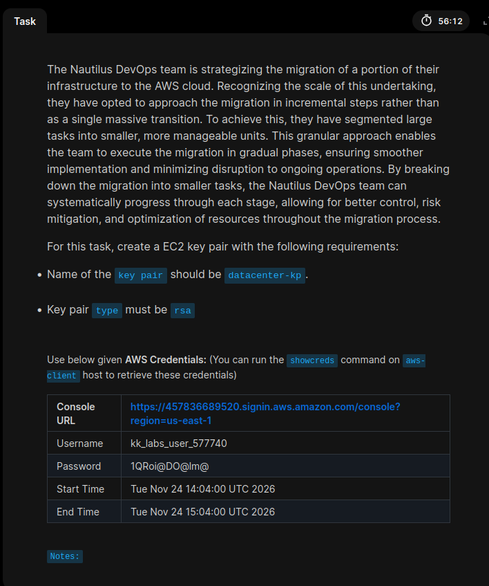
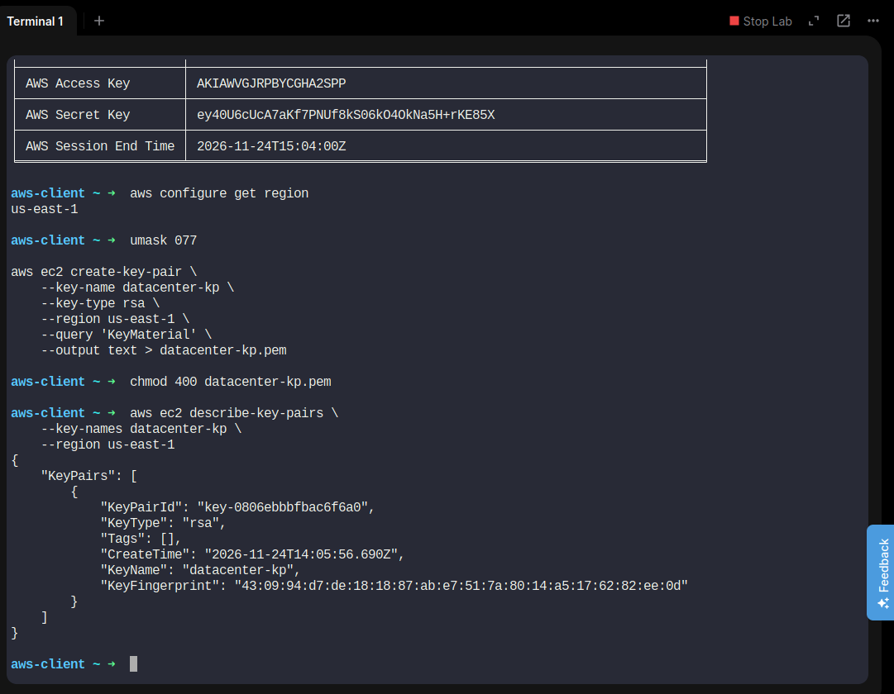

# Day 01 – Create an AWS EC2 Key Pair 🔑


**Platform:** KodeKloud Engineer  
**Challenge:** 100 Days of Cloud (AWS)  
**Date:** 24 November 2026  
**Category:** AWS | EC2 | Cloud Security

---

## 📌 Task Overview

The Nautilus DevOps team is planning to migrate a portion of its infrastructure to AWS Cloud.

As part of this migration, the requirement was to create an Amazon EC2 key pair with a specific name and key type using AWS.

The task was completed using AWS CLI from the AWS client machine.

## 🎯 Task Requirements

| Parameter | Required Configuration |
|---|---|
| AWS Service | Amazon EC2 |
| Key Pair Name | `datacenter-kp` |
| Key Pair Type | RSA |
| AWS Region | `us-east-1` |
| Status | Completed |

---

## 🛠️ Solution and Implementation

### Step 1: Retrieve AWS Credentials

Executed:

```bash
showcreds
```

This command displays the temporary AWS credentials provided by the KodeKloud lab environment.

**Note:** Credentials should never be shared or uploaded to GitHub.

### Step 2: Verify AWS Region

Command:

```bash
aws configure get region
```

Output:

```text
us-east-1
```

### Step 3: Create an RSA Key Pair

Command:

```bash
umask 077

aws ec2 create-key-pair \
  --key-name datacenter-kp \
  --key-type rsa \
  --region us-east-1 \
  --query 'KeyMaterial' \
  --output text > datacenter-kp.pem
```

**Command Explanation:**

| Command / Option | Purpose |
|---|---|
| `aws ec2 create-key-pair` | Creates an EC2 key pair |
| `--key-name` | Specifies the key pair name |
| `--key-type rsa` | Specifies RSA encryption |
| `--region` | Specifies the AWS region |
| `--query 'KeyMaterial'` | Extracts the private key material |
| `--output text` | Returns the key material as text |
| `>` | Saves output into a local file |
| `umask 077` | Restricts default file permissions |

The private key was saved locally as `datacenter-kp.pem`.

### Step 4: Set Private Key Permissions

Command:

```bash
chmod 400 datacenter-kp.pem
```

This gives the file read permission only to its owner.

It helps protect the private key from unauthorized access.

### Step 5: Verify Key Pair Creation

Command:

```bash
aws ec2 describe-key-pairs \
  --key-names datacenter-kp \
  --region us-east-1
```

**Verification Result:**

The AWS CLI successfully returned the key pair information.

| Parameter | Result |
|---|---|
| Key Pair Name | `datacenter-kp` |
| Key Type | `rsa` |
| Region | `us-east-1` |
| Creation Status | Successful |

---

## 📸 Screenshots

### 1. Key Pair Creation

The screenshot shows the AWS CLI command used to create the RSA key pair.



### 2. Key Pair Verification

The screenshot shows the successful verification of the `datacenter-kp` key pair.



---

## 🧠 Key Learnings

Through this hands-on task, I learned:

1. How to create an EC2 key pair using AWS CLI.
2. The purpose of RSA key pairs in EC2 authentication.
3. How AWS generates and provides private key material.
4. How to secure private keys using Linux file permissions.
5. How to verify AWS resources using `describe-key-pairs`.
6. The importance of specifying the correct AWS region.

## 🔐 Security Best Practices

- Never upload `.pem` private keys to GitHub.
- Never expose AWS access keys or secret keys.
- Always restrict private key file permissions.
- Follow the principle of least privilege.
- Protect temporary AWS credentials.

---

## ✅ Task Completion

**Day 01: Successfully Completed!**

Created and verified an RSA EC2 key pair named `datacenter-kp` in the `us-east-1` region using AWS CLI.

**Platform:** KodeKloud Engineer

**Challenge Progress:** 1 / 100

---

### 🚀 Learning Journey

*Learn • Build • Automate • Deploy*

One task at a time. Building practical Cloud and DevOps skills.

