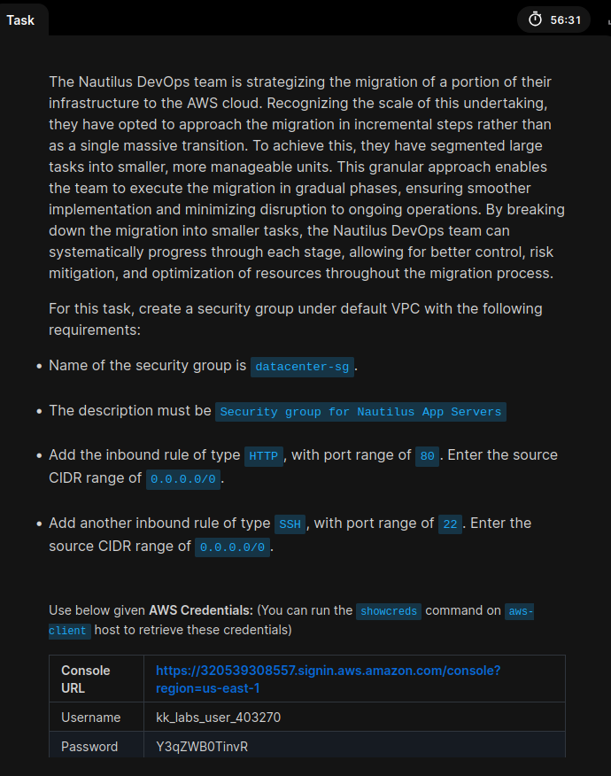
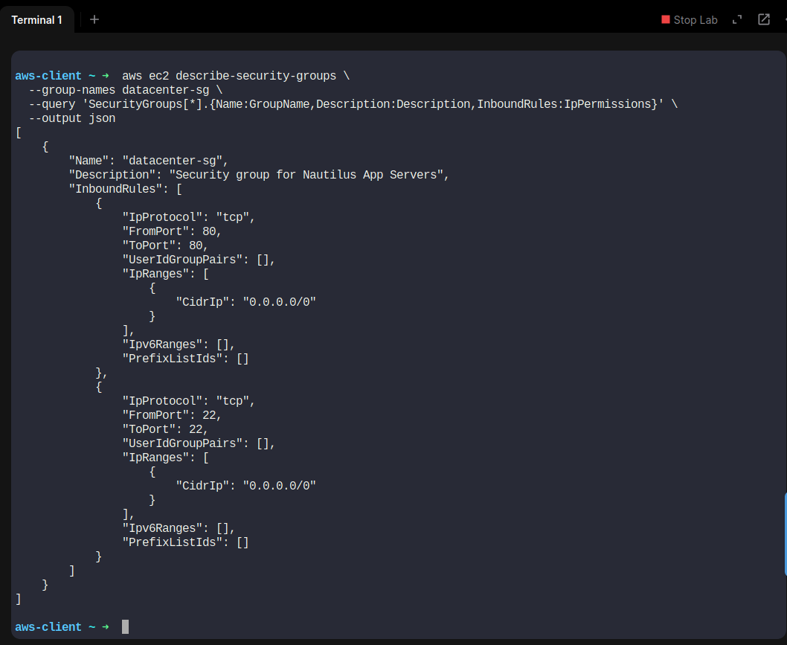

# Day 02: Create AWS Security Group

## 📌 Task Overview

The Nautilus DevOps team is migrating infrastructure to AWS in multiple phases.

As part of this migration, the task was to create a Security Group in the default VPC to control inbound traffic for application servers.

## 🎯 Task Requirements

| Parameter | Configuration |
|---|---|
| AWS Region | us-east-1 |
| VPC | Default VPC |
| Security Group Name | datacenter-sg |
| Description | Security group for Nautilus App Servers |
| Inbound Rule 1 | HTTP (TCP) |
| Port | 80 |
| Source | 0.0.0.0/0 |
| Inbound Rule 2 | SSH (TCP) |
| Port | 22 |
| Source | 0.0.0.0/0 |

## 🛠️ Solution

### Step 1: Configure AWS Region

```bash
export AWS_DEFAULT_REGION=us-east-1
```

### Step 2: Retrieve Default VPC ID

```bash
VPC_ID=$(aws ec2 describe-vpcs \
  --filters Name=isDefault,Values=true \
  --query 'Vpcs[0].VpcId' \
  --output text)

echo $VPC_ID
```

### Step 3: Create Security Group

```bash
aws ec2 create-security-group \
  --group-name datacenter-sg \
  --description "Security group for Nautilus App Servers" \
  --vpc-id "$VPC_ID"
```

### Step 4: Allow HTTP Traffic (Port 80)

```bash
aws ec2 authorize-security-group-ingress \
  --group-name datacenter-sg \
  --protocol tcp \
  --port 80 \
  --cidr 0.0.0.0/0
```

### Step 5: Allow SSH Traffic (Port 22)

```bash
aws ec2 authorize-security-group-ingress \
  --group-name datacenter-sg \
  --protocol tcp \
  --port 22 \
  --cidr 0.0.0.0/0
```

### Step 6: Verify Security Group

```bash
aws ec2 describe-security-groups \
  --group-names datacenter-sg \
  --query 'SecurityGroups[*].{Name:GroupName,Description:Description,InboundRules:IpPermissions}' \
  --output json
```

## 📸 Screenshots

### 1. Security Group Created



### 2. Inbound Rules Configured



## 📚 Key Learnings

- Understanding AWS Security Groups.
- Working with the default VPC.
- Configuring inbound traffic rules.
- Understanding HTTP (Port 80) and SSH (Port 22).
- Creating and managing AWS resources using AWS CLI.

## ✅ Task Status

**Completed Successfully!**

Security Group ID: `sg-042ccdb1e1c7f5225`

Region: `us-east-1`

---
**Challenge:** KodeKloud – 49 Days of AWS  
**Day:** 02  

