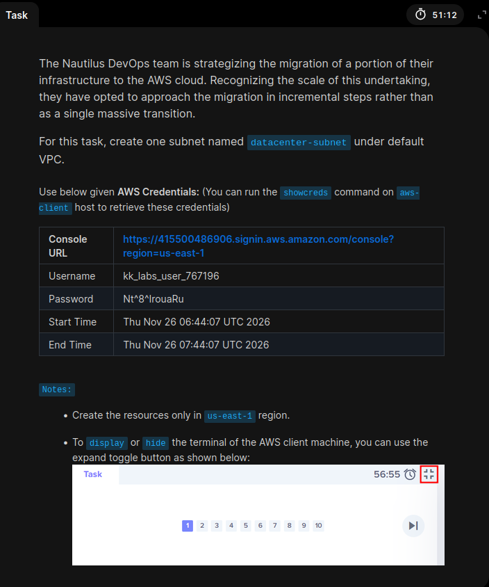
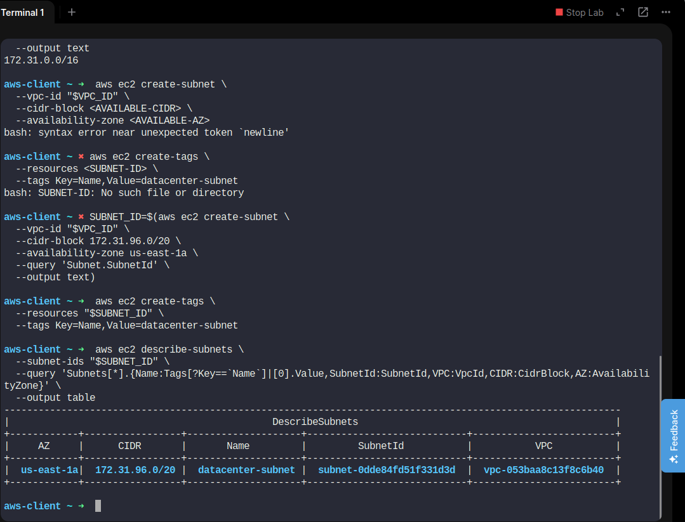

# Day 03: Create AWS Subnet

## Task

The Nautilus DevOps team needs a new subnet in AWS.

Create a subnet with the following requirements:

- **Subnet Name:** datacenter-subnet
- **Region:** us-east-1
- **VPC:** Default VPC

## Solution

### Step 1: Configure AWS Region

```bash
export AWS_DEFAULT_REGION=us-east-1
```

### Step 2: Identify the Default VPC

```bash
aws ec2 describe-vpcs \
  --filters Name=isDefault,Values=true \
  --query 'Vpcs[*].{VpcId:VpcId,CIDR:CidrBlock}' \
  --output table
```

### Step 3: Create the Subnet

```bash
VPC_ID=$(aws ec2 describe-vpcs \
  --filters Name=isDefault,Values=true \
  --query 'Vpcs[0].VpcId' \
  --output text)

SUBNET_ID=$(aws ec2 create-subnet \
  --vpc-id "$VPC_ID" \
  --cidr-block 172.31.96.0/20 \
  --availability-zone us-east-1a \
  --query 'Subnet.SubnetId' \
  --output text)
```

### Step 4: Add a Name Tag

```bash
aws ec2 create-tags \
  --resources "$SUBNET_ID" \
  --tags Key=Name,Value=datacenter-subnet
```

### Step 5: Verify the Subnet

```bash
aws ec2 describe-subnets \
  --subnet-ids "$SUBNET_ID" \
  --query 'Subnets[*].{Name:Tags[?Key==`Name`]|[0].Value,SubnetId:SubnetId,VPC:VpcId,CIDR:CidrBlock,AZ:AvailabilityZone}' \
  --output table
```

## Final Output

| Property | Value |
|---|---|
| Subnet Name | datacenter-subnet |
| Subnet ID | subnet-0dde84fd51f331d3d |
| VPC ID | vpc-053baa8c13f8c6b40 |
| Subnet CIDR | 172.31.96.0/20 |
| Availability Zone | us-east-1a |
| Region | us-east-1 |
| Status | Successfully Created |

## Screenshots

### 1. Subnet Creation


### 2. Subnet Verification


## Key Learnings

1. A VPC is a logically isolated network in AWS.
2. A subnet is a smaller network inside a VPC.
3. Each subnet belongs to one Availability Zone.
4. CIDR defines the IP address range.
5. Tags help identify and organize AWS resources.

**Task Status: Completed**
