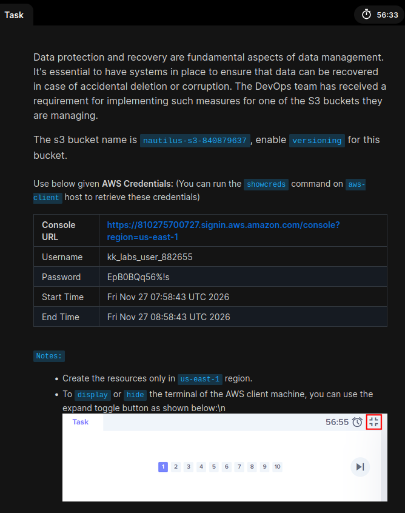
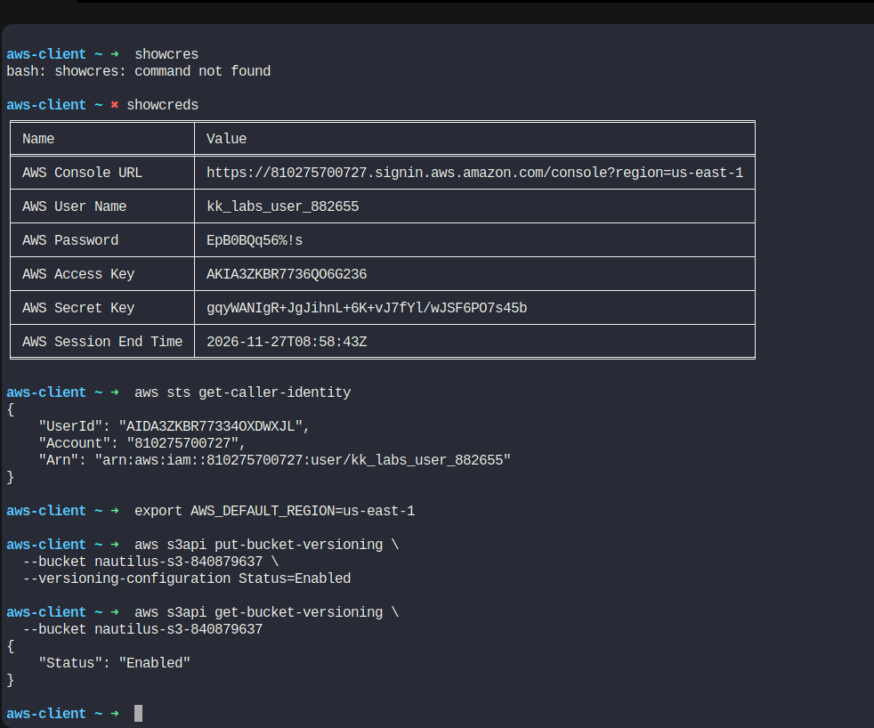

# Day 04: Enable S3 Bucket Versioning

## Task

The DevOps team needs to implement data protection and recovery for an S3 bucket.

**Requirement:** Enable versioning for the following S3 bucket.

- Bucket Name: `nautilus-s3-840879637`
- AWS Region: `us-east-1`
- Required Configuration: Versioning Enabled

## Solution

### Step 1: Verify AWS Identity

```bash
aws sts get-caller-identity
```

### Step 2: Configure AWS Region

```bash
export AWS_DEFAULT_REGION=us-east-1
```

### Step 3: Enable S3 Bucket Versioning

```bash
aws s3api put-bucket-versioning \
  --bucket nautilus-s3-840879637 \
  --versioning-configuration Status=Enabled
```

### Step 4: Verify Versioning Status

```bash
aws s3api get-bucket-versioning \
  --bucket nautilus-s3-840879637
```

Expected output:

```json
{
    "Status": "Enabled"
}
```

## Final Configuration

| Property | Value |
|---|---|
| Service | Amazon S3 |
| Bucket Name | nautilus-s3-840879637 |
| Region | us-east-1 |
| Versioning | Enabled |
| Status | Successfully Completed |

## Screenshots

### 1. Enable S3 Versioning



### 2. Verify S3 Versioning



## Key Learnings

1. S3 Versioning maintains multiple versions of objects in a bucket.
2. It helps recover objects after accidental deletion or overwriting.
3. `put-bucket-versioning` enables versioning.
4. `get-bucket-versioning` verifies the versioning configuration.
5. Versioning is useful for data protection and recovery.

**Task Status: Completed Successfully**

