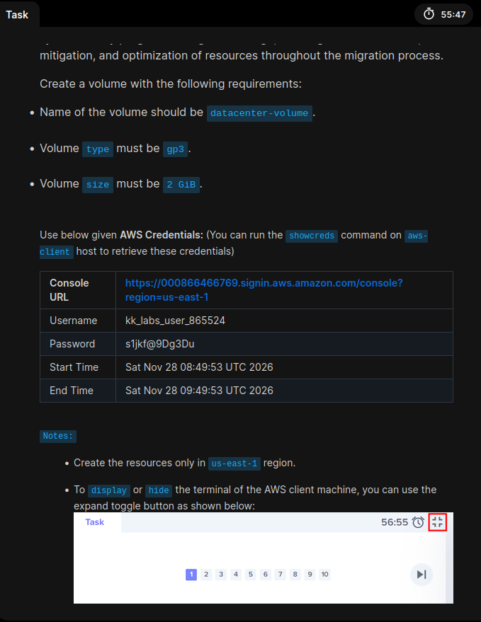
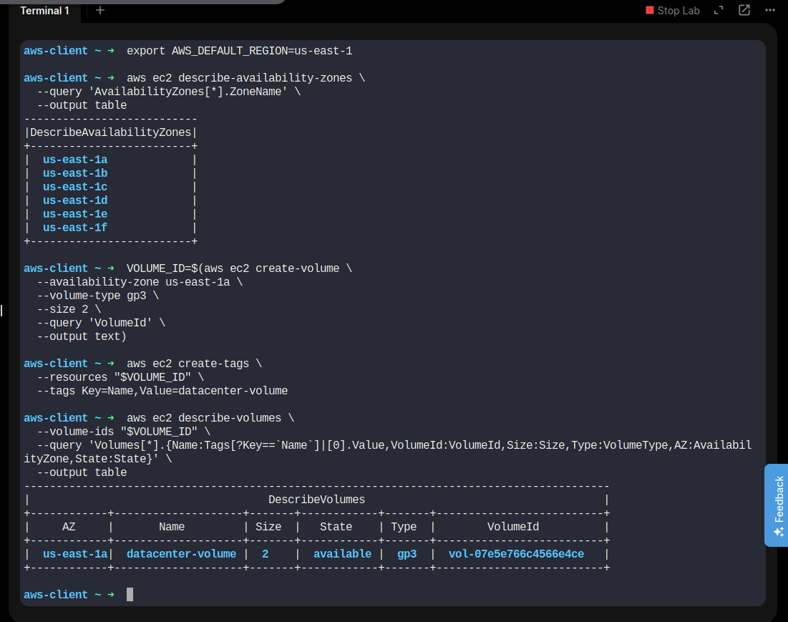

# Day 05: Create AWS EBS Volume

## Task

The Nautilus DevOps team requires a new EBS volume for its AWS infrastructure.

Create an EBS volume with the following requirements:

- **Volume Name:** `datacenter-volume`
- **Volume Type:** `gp3`
- **Volume Size:** `2 GiB`
- **AWS Region:** `us-east-1`

## Solution

### Step 1: Verify AWS Identity

```bash
aws sts get-caller-identity
```

### Step 2: Configure AWS Region

```bash
export AWS_DEFAULT_REGION=us-east-1
```

### Step 3: Check Available Availability Zones

```bash
aws ec2 describe-availability-zones \
  --query 'AvailabilityZones[*].ZoneName' \
  --output table
```

### Step 4: Create EBS Volume

```bash
VOLUME_ID=$(aws ec2 create-volume \
  --availability-zone us-east-1a \
  --volume-type gp3 \
  --size 2 \
  --query 'VolumeId' \
  --output text)
```

### Step 5: Add Name Tag

```bash
aws ec2 create-tags \
  --resources "$VOLUME_ID" \
  --tags Key=Name,Value=datacenter-volume
```

### Step 6: Verify EBS Volume

```bash
aws ec2 describe-volumes \
  --volume-ids "$VOLUME_ID" \
  --query 'Volumes[*].{Name:Tags[?Key==`Name`]|[0].Value,VolumeId:VolumeId,Size:Size,Type:VolumeType,AZ:AvailabilityZone,State:State}' \
  --output table
```

## Final Configuration

| Property | Value |
|---|---|
| Service | Amazon EBS |
| Volume Name | datacenter-volume |
| Volume Type | gp3 |
| Volume Size | 2 GiB |
| Region | us-east-1 |
| State | Available |

## Screenshots

### 1. EBS Volume Creation



### 2. EBS Volume Verification



## Key Learnings

1. Amazon EBS provides persistent block storage for EC2 instances.
2. EBS volumes are created in a specific Availability Zone.
3. gp3 is a General Purpose SSD volume type.
4. AWS CLI can create and manage EBS volumes.
5. AWS tags help identify and organize cloud resources.

**Task Status: Completed Successfully**
